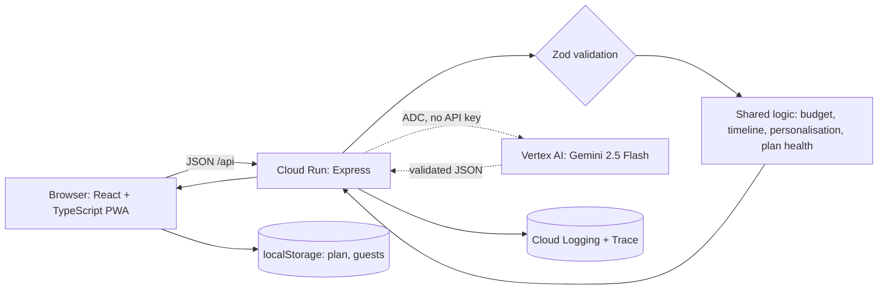

# Architecture

## Key decisions

| Decision                                                     | Why                                                                                        |
| ------------------------------------------------------------ | ------------------------------------------------------------------------------------------ |
| Money and dates are computed in code, not by the model       | Totals always add up exactly (property-tested); the AI cannot corrupt numbers              |
| AI enriches, never gates                                     | Every feature works offline; if Gemini is slow, invalid or missing, the plan still ships   |
| One shared `shared/` package used by client and server       | Same validation rules on both sides, no drift                                              |
| Largest-remainder rounding for re-budgeting                  | Amounts are integers, non-negative and sum to the total for any AI percentages             |
| Data stays in the browser                                    | No accounts or database to secure; share links are validated on open                       |
| Tests at every layer, including client↔server contract tests | A mismatch between UI and API fails the build                                              |
| Compiled server (esbuild) in production                      | Fast cold starts and a small image; no TypeScript tooling at runtime                       |
| Deep health check `/api/health/ai`                           | Proves the model really answers, not just that it is configured; the deploy script uses it |
| Code splitting with React.lazy                               | The guest list loads on demand, reducing the initial JS payload                            |
| React.memo on every presentational component                 | Prevents unnecessary re-renders when sibling state changes                                 |
| noUncheckedIndexedAccess in TypeScript                       | Array and record lookups are never assumed safe; forces explicit null handling             |

## Layout

`shared/` pure logic and schemas · `server/` Express app, AI adapter, env validation · `client/` React UI (`usePlanSession.ts` owns state and server calls; `components/` holds one file per section; `lib.ts` holds storage and API helpers) · `public/` PWA assets · `scripts/` performance budget.
